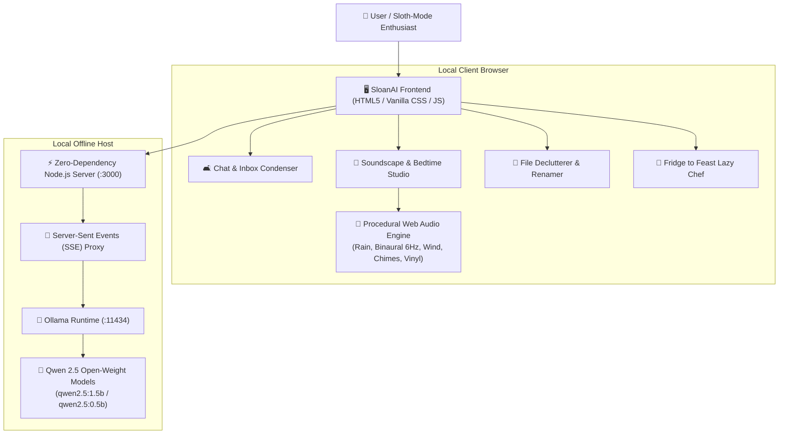

# 🦥 SloanAI
### *The Slow & Steady Offline AI Companion for the Beautifully Lazy*

> **A submission for the [Hacktoberfest Open-Source AI Challenge Week 3: Slow and Steady](https://dev.to/challenges/hacktoberfest-week3-2026-10-19)**  
> *Built with open-weight models (`Qwen 2.5`), local inference via Ollama, and procedural Web Audio API acoustic soundscapes.*

---

## 🌟 Overview

In honor of **International Sloth Day** (October 20) and inspired by [Sloan](https://dev.to/sloan), the beloved mascot sloth of the DEV Community, **SloanAI** is a 100% offline, privacy-first companion engineered to conserve your human energy. 

Sloths move at their own pace and conserve their energy — and modern developers and power users shouldn't have to burn out reading endless group chats, tidying downloads folders, or staring into an open fridge. SloanAI delegates the mundane cognitive chores to a local open-weight AI that runs on your laptop with **no internet connection, zero API bills, and total data sovereignty**.

---

## 🚀 Key Features (The 4 "Conserve Energy" Modules)

### 1. 🛋️ The 2-Minute Lazy Catchup (Chat & Inbox Digest)
* **The Problem:** Returning from a break to 300 unread messages across Slack, WhatsApp, Discord, or rambling email chains.
* **The Sloth Solution:** Paste the raw chat dump. Local `Qwen 2.5` filters out 90% of the conversational noise and hands you:
  - **The Sloth's Verdict:** A 2-sentence executive brief.
  - **What You Can Safely Ignore:** Filtered banter, food debates, and memes.
  - **Critical Action Items:** Only what strictly requires you, ranked by lowest effort.
  - **1-Click Lazy Replies:** Interactive buttons to copy pre-drafted polite replies (*"Sounds great, approved!"*, *"Thanks, catching up on this next week"*).

### 2. 🌙 Offline Wind-Down & Procedural Soundscape Sanctuary
* **100% Procedural Web Audio Synthesis:** Real-time mathematical acoustic synthesis of:
  - Rainforest rainfall (filtered pink noise + stochastic raindrop bursts).
  - Binaural beats (theta rhythm at 6Hz difference for deep sleep and meditation).
  - Twilight breeze with pentatonic sinusoidal wind chimes.
  - Lo-Fi vinyl crackle and warmth.
  - *Zero audio assets streamed — 0 MB bandwidth required!*
* **AI Bedtime Story Generator:** Streams calm, slow-paced bedtime stories crafted by `Qwen 2.5` running locally.
* **Sloth Sleep Timer:** Automatically fades out audio exponentially.

### 3. 📂 The Lazy Declutterer & Rename Engine
* **The Problem:** Hundreds of screenshots (`Screen Shot 2026-10-21 at 14.33.12.png`), invoices, and random downloads piling up.
* **The Sloth Solution:** Paste your messy file list. SloanAI semantically categorizes files into clean folders, invents clean human-readable names, and generates ready-to-run copyable **Windows PowerShell** and **macOS/Linux Bash** scripts.

### 4. 🥑 Fridge to Feast (The Minimal-Effort Chef)
* **The Problem:** Hungry, exhausted, staring into the fridge with random leftover scraps.
* **The Sloth Solution:** Type the 2-3 random ingredients you have (e.g. *cold rice, 1 egg, soy sauce*). SloanAI invents a meal adhering to the **Strict 1-Pan Rule** (Prep time < 5 mins, Cook time < 10 mins, Maximum 1 dish to wash).

### 5. 🦥 "Sloth Energy Conserved" Scoreboard
* Real-time tracker calculating cognitive minutes saved, words skipped, and lazy replies generated, stored locally in `localStorage`.

---

## 🧠 Why Open Innovation Matters for SloanAI

| Criterion | Closed APIs (OpenAI / Anthropic / Google Cloud) | Open-Source AI (SloanAI + Qwen 2.5 via Ollama) |
| :--- | :--- | :--- |
| **Data Privacy** | Sensitive group chats, personal emails, and private filenames are uploaded to corporate servers. | **100% Local & Private.** Personal data never leaves your RAM/disk. |
| **Offline Resilience** | Completely non-functional on airplanes, in remote cabins, or during Wi-Fi outages. | **True Offline Autonomy.** Runs anywhere on Earth with zero internet. |
| **Operating Cost** | Recurring token fees, subscriptions, and per-call charges. | **$0.00 Forever.** Install once, run unlimited inference for free. |
| **Model Sovereignty** | Forced model deprecations, behavior changes, and API downtime. | **Full Control.** Pick `qwen2.5:1.5b`, `qwen2.5:0.5b`, `llama3.2`, or fine-tune your own sloth model. |

---

## 🏗️ Architecture



---

## 🛠️ Quickstart (Running Locally)

### Prerequisites
1. **Node.js** (v18+)
2. **Ollama** installed: [ollama.com](https://ollama.com)
3. Pull the open-weight model:
   ```bash
   ollama pull qwen2.5:1.5b
   ```

### Launch SloanAI
```bash
# Clone the repository
git clone https://github.com/your-username/sloan-ai.git
cd sloan-ai

# Start the local server (Zero npm dependencies needed!)
npm start
```

Open your browser to:
```
http://localhost:3000
```

---

## 📄 License
This project is open-source and licensed under the [MIT License](LICENSE).
