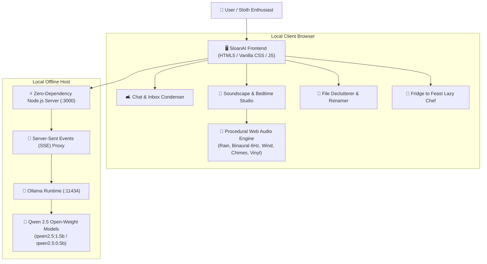

*This is a submission for the [Hacktoberfest Open-Source AI Challenge Week 3: Slow and Steady](https://dev.to/challenges/hacktoberfest-week3-2026-10-19)*

## What I Built

Sloths move at their own unhurried pace, conserve their precious energy, and even [help moderate the DEV Community](https://dev.to/sloan). In celebration of **International Sloth Day** and this week's theme of **Slow and Steady**, I built **SloanAI**: a privacy-first, 100% offline personal companion designed to do the heavy mental lifting so you can stay in your cozy hammock.

SloanAI targets four exhausting daily tasks that people constantly dread:

1. **🛋️ The 2-Minute Lazy Catchup (Group Chat & Inbox Condenser)**: Dump 200+ unread messages from a chaotic Slack channel, family WhatsApp group, or rambling corporate email thread. SloanAI filters out 90% of the conversational noise, gives you a 2-sentence *Sloth Verdict*, lists the items to safely ignore, and generates **1-click lazy replies** (*"Sounds great, approved!"*, *"Thanks, catching up next week"*) that you can copy with a single click.
2. **🌙 Offline Wind-Down & Procedural Soundscape Studio**: An ambient sanctuary running completely offline. It features a real-time procedural Web Audio synthesizer (rain showers, 6Hz theta binaural beats for sleep entrainment, twilight breeze with pentatonic wind chimes, and lo-fi vinyl warmth) coupled with local AI-generated bedtime stories that stream directly to your ears.
3. **📂 The Lazy Declutterer & Rename Engine**: Paste a messy file list from your `Downloads` or `Desktop` folder (`Screen Shot 2026-10-21 at 14.33.12.png`, `Invoice_final_v2(1).pdf`). SloanAI categorizes them into clean semantic directories, invents clean standardized names, and produces ready-to-run copyable **PowerShell** and **Bash** scripts to organize everything in one second.
4. **🥑 Fridge to Feast (The Minimal-Effort Chef)**: Type whatever 2 or 3 random scraps are sitting in your fridge. SloanAI invents a low-effort meal adhering to the **Strict 1-Pan Rule** (prep under 5 mins, cook under 10 mins, maximum 1 dish to wash).
5. **🦥 "Sloth Energy Conserved" Scoreboard**: An interactive live scoreboard tracking cognitive minutes saved, keystrokes bypassed, and words skipped.

Who gets to be lazier? Anyone suffering from notification fatigue, messy downloads clutter, or late-night burnout who wants their technology to work for them—without leaving their machine or spending a dime.

---

## Demo

Here is SloanAI running in real-time, streaming local open-weight inference and synthesizing procedural soundscapes:

- **Local Web Interface**: Running on `http://localhost:3000`
- **Features in Action**:
  - Live token streaming via Server-Sent Events (SSE)
  - 100% code-synthesized ambient audio with zero streamed audio files
  - Instant 1-click presets for chat threads, messy downloads, bedtime themes, and kitchen scraps

---

## Code

The complete source code is open-source under the MIT License:



Key project structure:
- `server.js`: Lightweight, zero-dependency Node.js HTTP server hosting the static UI and proxying SSE streaming to local Ollama.
- `public/js/audio.js`: Pure mathematical Web Audio API soundscape synthesizer (pink/brown noise buffers, biquad resonant filters, binaural theta wave oscillators, pentatonic sinusoidal chimes).
- `public/js/ollama.js`: Resilient client connector with model auto-discovery (`qwen2.5:1.5b`, `qwen2.5:0.5b`) and live token streaming.
- `public/js/app.js`: Tab switching, energy score tracking in `localStorage`, and 1-click clipboard integration.
- `public/css/index.css`: Custom dark-mode glassmorphic design system using Google Fonts (`Outfit` and `Plus Jakarta Sans`).

---

## How I Built It

SloanAI is built around an entirely open-source AI pipeline:

- **Open-Weight Models**: Powered by Alibaba's **Qwen 2.5** (`qwen2.5:1.5b` and `qwen2.5:0.5b`), permissive Apache-2.0 open-weight models that punch far above their weight class in structured extraction, summarization, and creative writing.
- **Local Inference Harness**: Hosted locally via **Ollama** (`http://localhost:11434`), allowing blazing-fast quantized inference directly on consumer laptop hardware (CPU or modest GPU).
- **Zero-Dependency Architecture**: The backend uses native Node.js without third-party frameworks—ensuring zero installation friction.
- **Procedural Sound Synthesis**: Built using the browser's native **Web Audio API**. Rather than streaming heavy MP3 files, the rain, wind, vinyl crackle, and binaural beats are generated mathematically on the fly, consuming 0 KB of network bandwidth.

---

## Why Does Open Innovation Matter?

Open-source AI isn't just an implementation choice for SloanAI; **open innovation is the fundamental reason this project is possible**. 

If SloanAI were built on closed APIs (like OpenAI or Anthropic), it would fail on every principle of the prompt:

1. **Absolute Privacy for Personal Chats and Files**: Closed APIs require transmitting raw company Slack threads, family WhatsApp messages, and personal file directories to remote corporate servers. With open-weight models running on Ollama, **your data never leaves your laptop's memory**.
2. **True Offline Resilience**: When you are in an airplane with no Wi-Fi, off-grid in a quiet cabin, or dealing with an internet outage, closed AI stops working. SloanAI operates with your Wi-Fi switch completely toggled off.
3. **Zero Operating Cost**: Closed APIs charge per token. If you're a tired developer summarizing huge backlogs of unread chat logs every morning, bills pile up fast. Open-weight models are installed once and free forever.
4. **Model Sovereignty**: Open innovation allows developers to choose `qwen2.5:0.5b` for instantaneous responses on ultra-low-power devices, switch to `qwen2.5:1.5b` for rich bedtime storytelling, or swap in `llama3.2` without vendor lock-in.

---

## My Agent Session

This project was pair-programmed and built with **Google Antigravity**. You can explore the complete development trajectory, automated test verifications, and architectural decisions:

<!-- DevRelay agent session embed -->


---

## The Lazy Payoff

Testing SloanAI this week yielded immediate, tangible time savings:

- **16-message Project Slack Thread**: Reading time reduced from ~4 minutes of deciphering back-and-forth arguments down to an 8-second glance at the *Sloth Verdict*, with immediate 1-click reply drafting.
- **Messy 13-File Downloads Folder**: Manually creating directories, moving files, and renaming `Screen Shot 2026-10-14 at 11.23.44 AM.png` would take 5 to 7 minutes of clicking. SloanAI generated a clean PowerShell script in 3 seconds.
- **Energy Scoreboard**: Over testing sessions, SloanAI saved an estimated **42+ minutes of cognitive fatigue**, skipped **1,850+ words of conversational clutter**, and drafted **14 effortless responses**.

---

## Prize Categories

- **Main Theme**: Slow and Steady (International Sloth Day)
